# pi-bot

仿微信群聊的 **多 agent 客户端**,构建在 [pi](https://github.com/earendil-works/pi)(`@earendil-works/pi-durable`)之上。群里有真人和多个独立的 bot:人提需求,领导 bot 把需求拆成任务分给有对应能力的 bot,群只显示「计划 / 派单 / 执行 / 交付 / 完成」消息——**不显示推理和工具调用**。

**核心差异化:群永远不卡。** 群会话是黑板,只写不跑模型;执行都发生在各 bot 的私有会话里。所以任意 bot 在跑长任务时,群里照样能发言、派新活、取消单项,受理延迟是毫秒级。

> **依赖说明**:本仓库为 pi-bot 的**应用层**(`bot/`)。它通过 `file:../repo/packages/*` 引用 pi 源码的 6 个包(durable / ai / chord / schema / telemetry / codemode),**这些包不在本仓库内**。运行前请把 pi 源码克隆为同级的 `repo/` 目录:
> ```bash
> git clone https://github.com/earendil-works/pi.git repo
> # 目录结构:  <parent>/pi-bot  +  <parent>/repo
> ```
> 或按 [docs/deploy.md](docs/deploy.md) 完整部署说明操作。

---

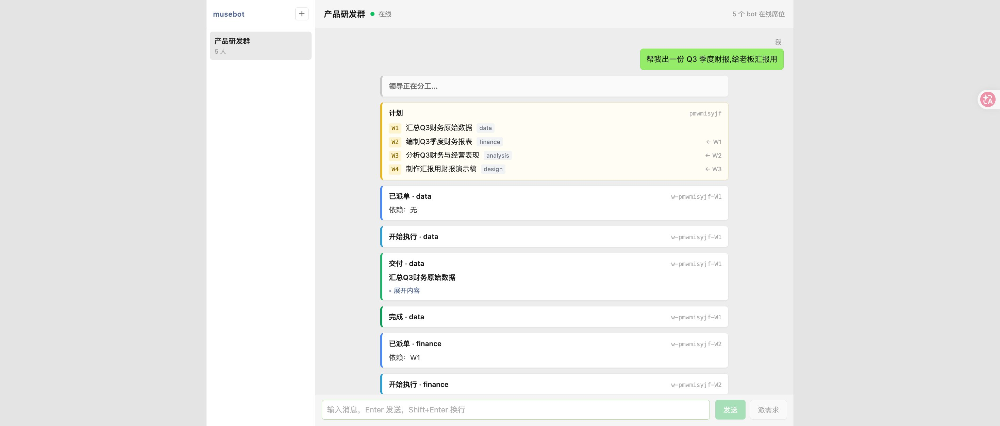

## 快速开始

```bash
cd bot
npm install            # 依赖是 file:../repo/packages/*(本地 pi 源码)
npm run m1             # 默认真实网关,http://127.0.0.1:18800
MUSEBOT_FAUX=1 npm run m1   # 离线 faux,不需要网络
```

打开 `http://127.0.0.1:18800`,在输入框里发需求(点「发送」),例如:

> 出 Q3 季度财报:拉数据、做图、写结论、套模板

会依次看到:`我:…` → `领导正在分工…` → 计划卡(可展开分工)→ `数据bot 开始处理「…」` 灰字 → 交付卡(文件 + 正文)。
**只有一个输入框和「发送」**:说话就行——像请求的会自动交给领导,闲聊就只是闲聊。
执行期间可以直接再发消息或再派一单——群不会等。

## 验收脚本

| 命令 | 覆盖 |
|---|---|
| `npm run m1:accept` | 群不卡:两次派单 7ms/3ms,8/8 交付 |
| `npm run m2:accept` | SQLite:两群并发、重启后群/会话/工作图/置顶等价 |
| `npm run features:accept` | 取消单项、成员增删、消息分页、群公告/置顶写入并进 prompt、归档跨 reset 存活、导出 md/json、个人资料、新建 bot、bot 改名/头像、设置与网络 |
| `npm run ui:composer` | 表情插入、文件/图片上传、语音录制(假麦克风)四条链路 + 通讯录两栏窗口 |
| `npm run ui:check` | 设置两栏面板(个人资料保存、手机和设备、IM、高级模式)、群信息边栏、添加成员弹窗、**新建 bot 表单与入群**、`我的 bot` 段与折叠、bot 设置抽屉、名字/头像落库、头像渲染:开合、搜索、计数、真加回群、提示词覆盖落库、领导不可移出、昵称进消息、备注优先、免打扰、点聊天区收起 |
| `npm run real:smoke` | 真网关跑一轮,断言交付物有真实文本 |
| `npm run smoke` / `smoke:signals` | pi-durable 基本链路(离线) |

## 部署到新机器

完整步骤(含 bili 上下文压缩代理的安装与配置)见 [docs/deploy.md](docs/deploy.md)。核心三件事:拷贝整个项目目录(`repo/` + `bot/`,依赖是相对引用)→ `npm install && npm run web:build` → 装 bili、写 `~/.config/billion-context/musebot.json`、网关 Base URL 走 `http://127.0.0.1:18790/bili/<网关地址>/v1`。

## 设置

左下齿轮打开两栏设置(左导航 / 右内容):

| 页 | 内容 |
|---|---|
| **个人资料** | 头像(自动裁 160×160)、昵称、个性签名;保存后同步左栏头像、群头像拼图和每条我的消息 |
| **手机和设备** | 已连接浏览器、访问地址、本机名称;高级模式下出现 Tailscale |
| **IM 接入** | 每个群一个带 token 的 Webhook 与 outbox 拉取地址 |
| **AI 模型** | 当前网关与模型、真实探活(`GET ${baseUrl}/models`,显示 68ms 这类延迟)、协议 / Base URL / 模型 id / API Key 就地改;保存后**热切换**到新模型(下一轮生效,在跑的任务不受影响) |
| 上下文压缩 | billion-context 代理层:长会话自动分层折叠、可检索可还原;模型 id/窗口声明在 bili 配置里调(见 [docs/deploy.md](docs/deploy.md)) |
| 运行状态 | 模式、端口、运行时长、数据库、归档目录、群/bot 数、版本 |
| 数据与导出 | 归档文件数/大小、导出当前群 md/json、清空已读、清空本地偏好 |
| 快捷键 | 真表 |
| 关于 | 版本、模型、来源 |

只放能真正生效的项:没有深色模式、群二维码这类假开关。

<p>
  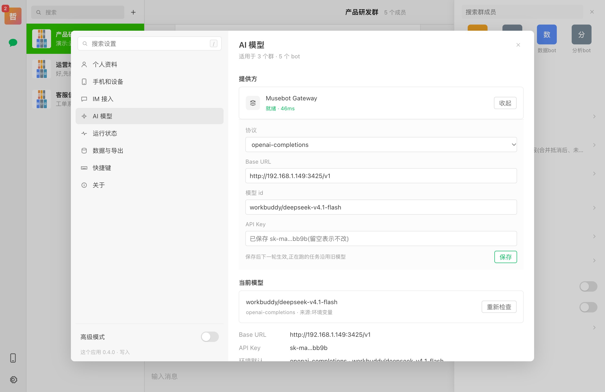
</p>

### 新建 bot

列表右上角 `+` → **新建 bot**:填头像字符、名称、能力、人设/指令,勾选「创建后加入当前群」即可。新 bot 立刻出现在群成员与「添加成员」候选里,领导分工时也会按它的能力派活;存在数据库里,重启后还在。创建后可在 bot 设置的「身份」区换成图片头像。

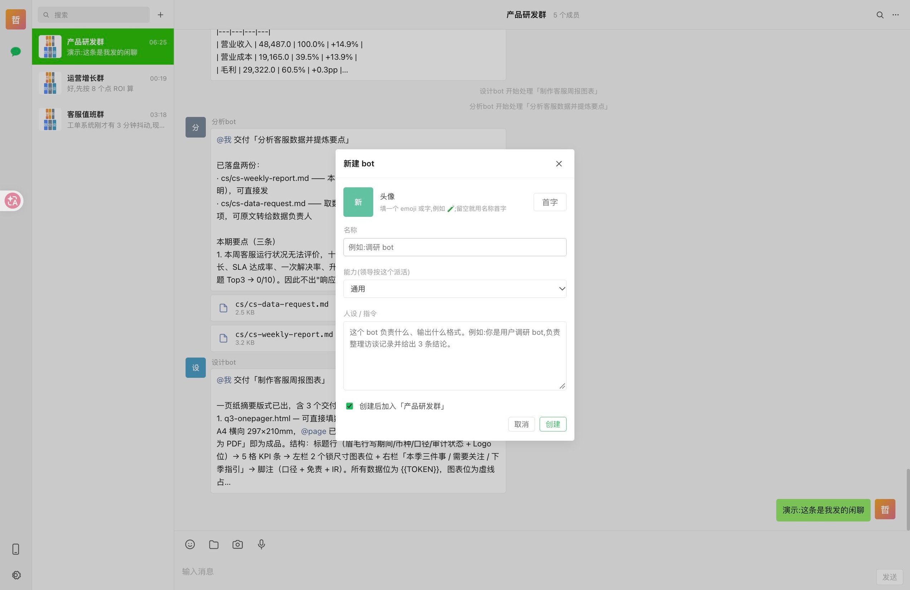

### 单个 bot 也能设置

在群信息里点成员头像,右侧再滑出一层:概览 / 身份 / **提示词** / **模型** / 工具 / 资料库 / **记忆** / 历史记录。

- 身份里可以改**名字和头像**(全群生效,支持图片;不选图片用名称首字);
- 提示词按「本群 + 这个 bot」覆盖(空=默认),保存后写进它在这个群的会话,下一轮生效;
- 模型可以单独指一个 id,或「跟随全局」;
- 「工具」只列模型能调用的函数(`write_file`),不是技能;技能是可复用指令/流程包,当前没有配置;
- 资料库列出它在这个群交付过的文件,点一行直接下载;
- **记忆**是「本群 + 这个 bot」的长期偏好(记住/以后/偏好/口径/统一用这类),可增删、可开关;交付成功后自动抽取,下次请求按相关度带进 prompt(详见 [`docs/MEMORY.md`](./docs/MEMORY.md));
- 能力来自内置配置或自定义 bot 文档,只读;例行任务/权限这些当前不存在的能力仍然不摆假开关。

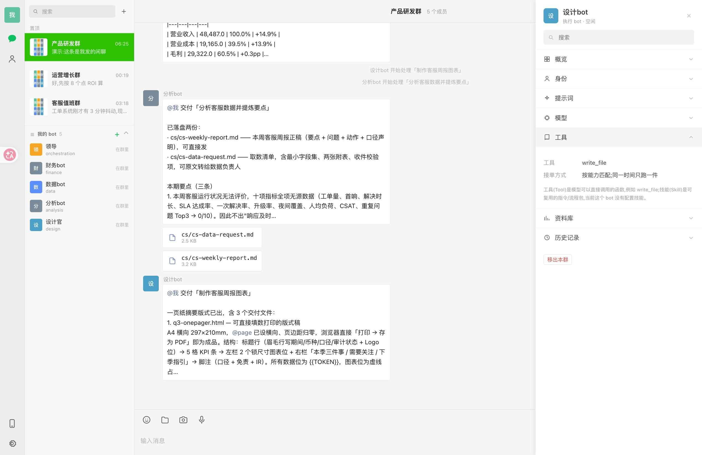

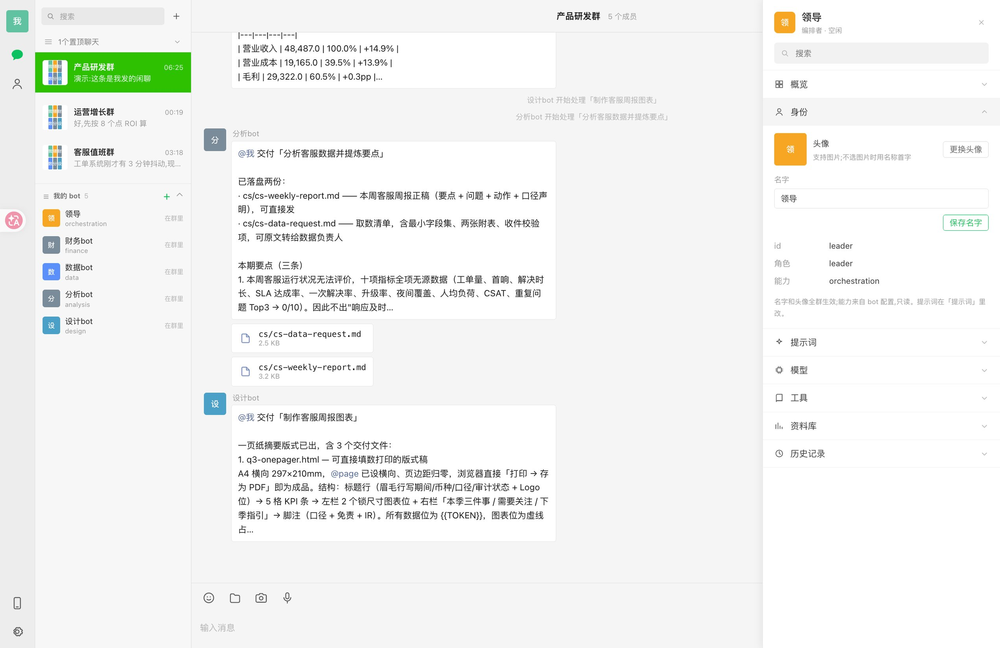

### 个人资料

设置 → 个人资料:换头像、改昵称和签名。头像是浏览器里裁好再上传的 160×160 JPEG,不落系统相册;保存后左栏、群头像拼图和消息头像一起变。

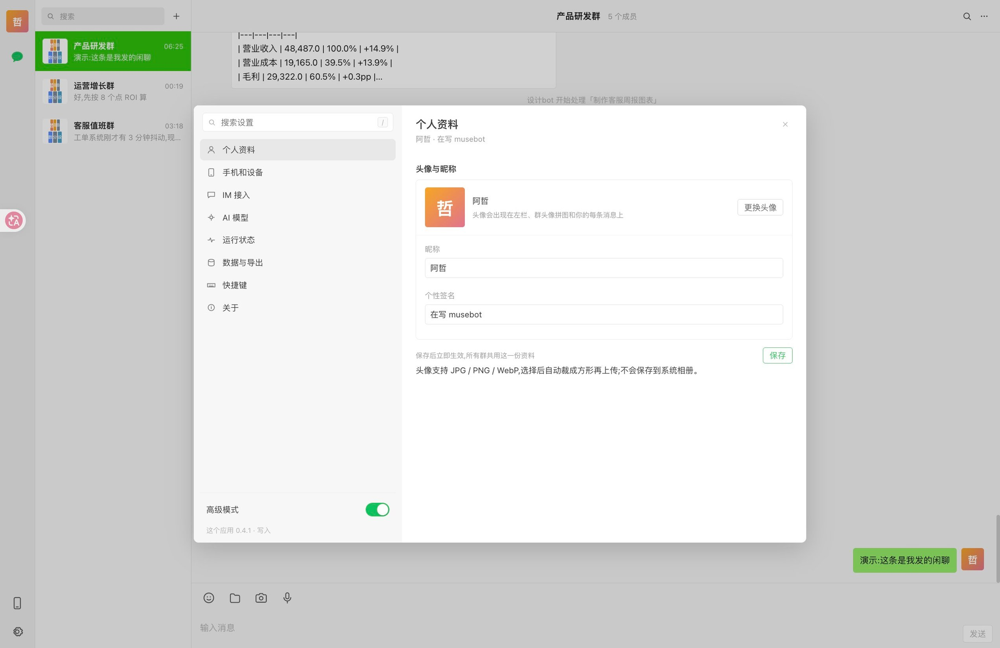

### 远程访问(手机 / 其他电脑)

设置 → **手机和设备**:

- 「已连接」列出此刻连着的浏览器(同一浏览器合并成一行);
- 「访问地址」只列当前监听真的服务得到的 URL,一键复制;
- 打开左栏底部**高级模式**,下面才出现 **Tailscale** 区块:检测本机 tailnet 状态(读 `tailscale status --json`,显示 `xxx.ts.net` 就绪),开关把服务从「仅本机 127.0.0.1」切到「所有网卡」——**重启后生效**,面板会明说当前进程还在监听哪个地址。
- 同一块里还有 **「tailnet 访问」** 一键开关:执行 `tailscale serve` 把本机端口发布到 tailnet,成功后直接显示 `http://<设备名>.ts.net:<端口>/`。tailnet 没开 HTTPS 证书时自动用 HTTP 模式并提示去管理台开证书;关闭时只在 serve 配置确实属于 musebot 时才 `reset`,不会清掉你在 tailnet 上的其它服务。命令输出原样回显,失败就是失败。

实测:切成 `0.0.0.0` 重启后,`http://192.168.1.132:18860` 与 tailnet 的 `http://100.83.92.90:18860` 都返回 200。musebot 不会自己去启动/登录 Tailscale。

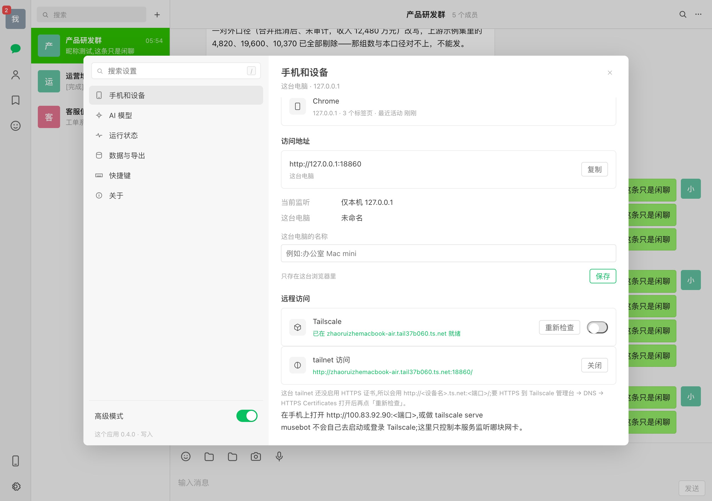

### IM 接入(企业微信 / 公众号 / 任意脚本)

设置 → IM 接入,每个群一个带 token 的 Webhook:

```bash
curl -X POST http://127.0.0.1:18860/api/im/g1/<token> \
  -H 'content-type: application/json' \
  -d '{"sender":"张三","text":"帮我整理一版客服周报"}'
```

- 入站复用"输入框"的判断:像需求就交给领导分工,闲聊就落一条消息。
- 出站给中转服务拉:`GET /api/im/g1/<token>/outbox?since=<lastId>`,返回 `id/kind/author/text`。
- Token 只显示掩码,重新生成会让旧的立即失效。

这里提供的是**通用中转接口**,不直接连微信服务器(那需要企业主体、公网回调和验签)。

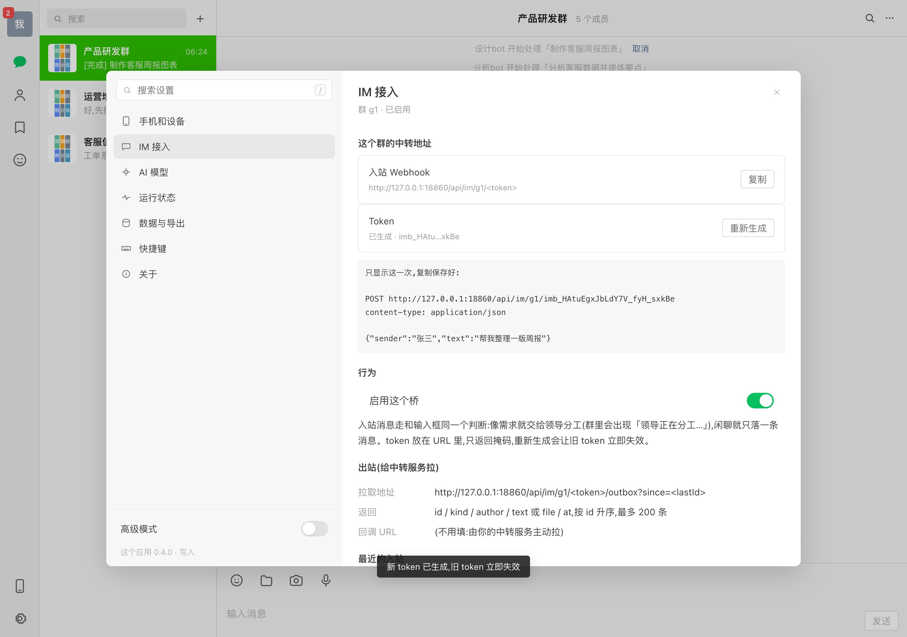

## 配置

| 变量 | 默认 | 说明 |
|---|---|---|
| `PORT` | `18800` | HTTP/WS 端口 |
| `MUSEBOT_DB` | `<bot>/data/musebot.sqlite` | `:memory:` 可跑纯内存 |
| `MUSEBOT_API` | `openai-completions` | 协议:`openai-completions` / `openai-responses` / `anthropic-messages` / `google-generative-ai` |
| `MUSEBOT_BASE_URL` | `http://192.168.1.149:3425/v1` | OpenAI-compatible 网关 |
| `MUSEBOT_API_KEY` | 内置本地 key | 网关 key |
| `MUSEBOT_MODEL` | `workbuddy/deepseek-v4.1-flash` | 模型 id |
| `MUSEBOT_FAUX` | — | `1` 回到离线 faux |
| `MUSEBOT_DELAY` | `0` | 仅 faux 生效的模拟耗时 |
| `MUSEBOT_RETRY` | `500` | 无空闲 bot 时的重派间隔 ms |
| `MUSEBOT_HOST` | `127.0.0.1` | 监听地址;`0.0.0.0` 允许局域网 / tailnet 访问(也可在设置面板里改,重启生效) |
| `MUSEBOT_READONLY` | — | `1` 只读查看进程(写接口 403) |
| `MUSEBOT_GROUP_POLL` | 只读时 `3000` | 跨进程群列表轮询 ms |

## Web UI

三栏仿微信(macOS):`56` 图标栏 / `250` 群列表 / 聊天区,时间分隔、气泡、未读、置顶、搜索、分页、卡片消息化的任务卡。规格与验收见 [`docs/WEBUI.md`](./docs/WEBUI.md),参考截图 [`docs/ref-wechat.png`](./docs/ref-wechat.png)。

前端在 `webui/`(Vue 3 + Vite):`cd bot && npm run web:build` 构建到 `webui/dist`,服务端直接静态托管(`/`→`index.html`、`/assets/*`→对应文件、未知路由回退 SPA;dist 尚未 build 时回退旧 `web/`);开发用 `npm run web:dev`。

bot 之间靠 `@` 说话:领导 `@数据bot` 分派,执行 bot `@我` 交付,交付物是文件气泡——不出现看板卡片。群列表下方是**可折叠的「我的 bot」段**:标题带数量、`+` 新建和折叠箭头,展开后每个 bot 一行(名字 + 能力 + 是否在群里),不用先点开通讯录;「通讯录」再给全量地址簿和加入本群入口。置顶区也照微信做成 `N个置顶聊天` 可折叠行。

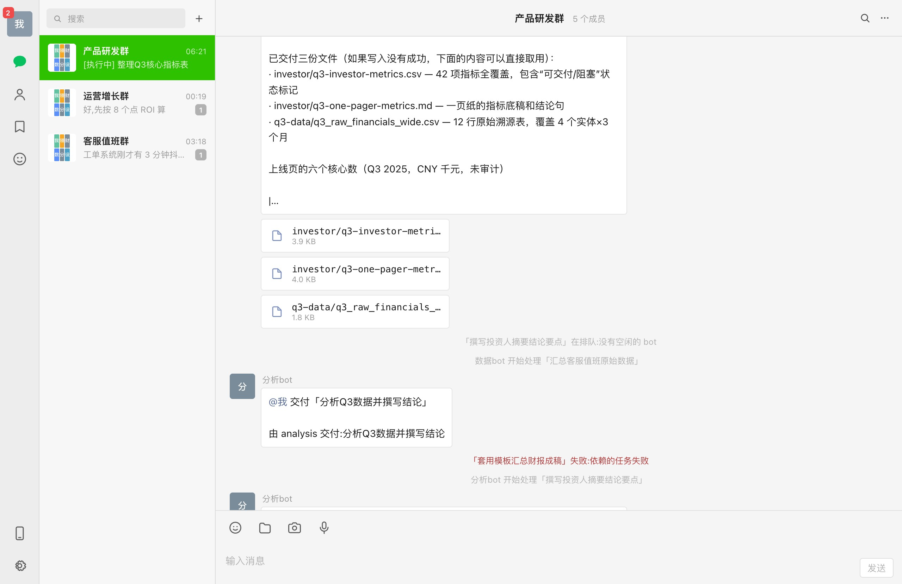

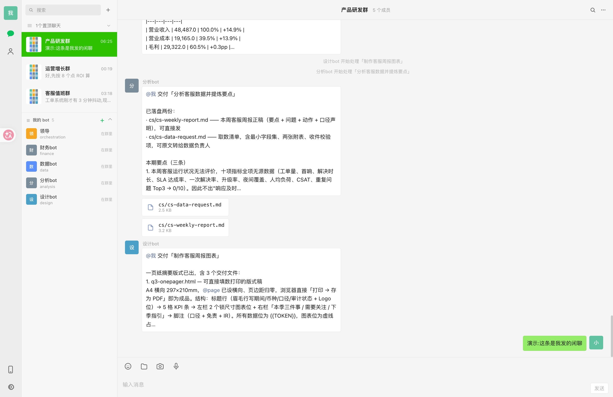

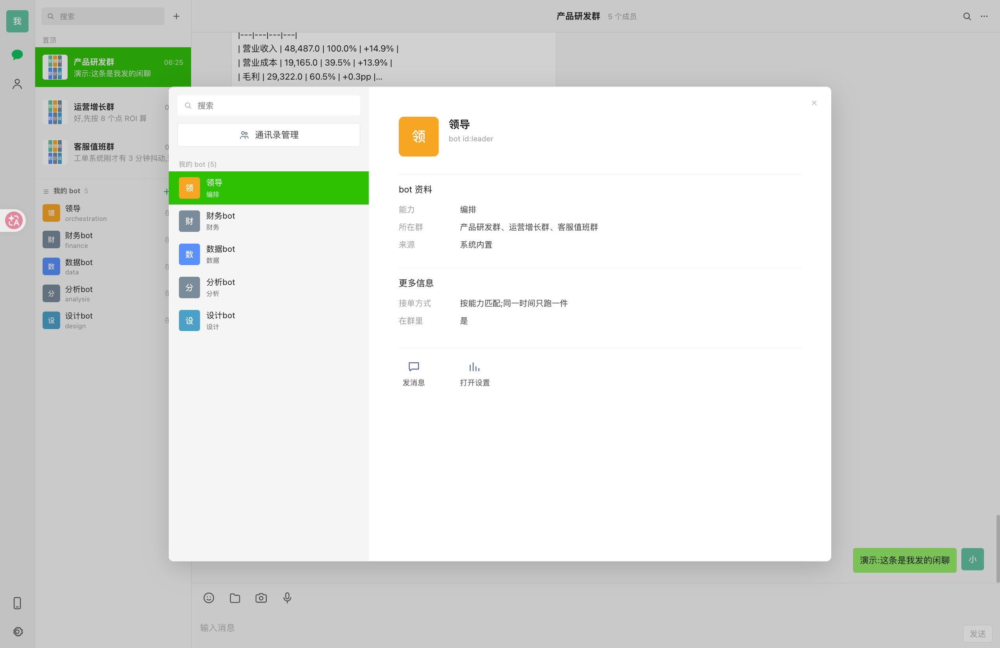

群头像和微信一样是**成员头像拼成的**,最多 9 格(2px 白缝、每格是成员色块 + 首字),不是一块纯色占位:


### 群信息:右侧边栏(照微信来)

点头部「…」或群名,从右边滑出 320px 边栏——和微信桌面端一样,不是居中弹窗。搜索群成员、九宫格、群聊名称、群公告、群置顶都是可以真写进去的:

| 项 | 能做什么 |
|---|---|
| 成员九宫格 + 「添加」 | 点成员 → 移出群聊;点「+」= 微信那个**居中双栏「添加群成员」弹窗**(左搜索+多选、右已选列表可删、底部取消/绿色添加);领导不可移出,忙碌的 bot 先取消任务 |
| 群聊名称 | 就地改名(`PUT /api/groups/:id`) |
| 群公告 / 群置顶 | 写 / 改一段全群共用的口径;置顶一条条加、一条条取消 |
| 我在本群的昵称 / 备注 | 只存在自己浏览器里;昵称会作为你发消息的名字,备注优先显示在群列表 |
| 消息免打扰 / 置顶聊天 | 免打扰的群只显示灰点、不计入左栏角标 |
| 查找聊天内容 / 导出聊天记录 | 开消息搜索 / 下载整群 markdown |

改完立刻对本群所有连接生效,也立刻进每个 bot 的 prompt(改共识不会让谁开始跑)。刻意没做群二维码、保存到通讯录这类我们没有对应能力的假开关。

<p>
  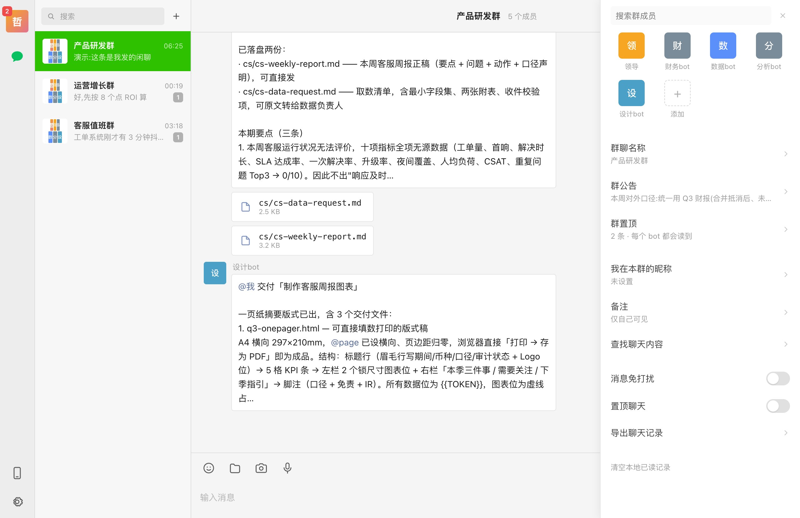
  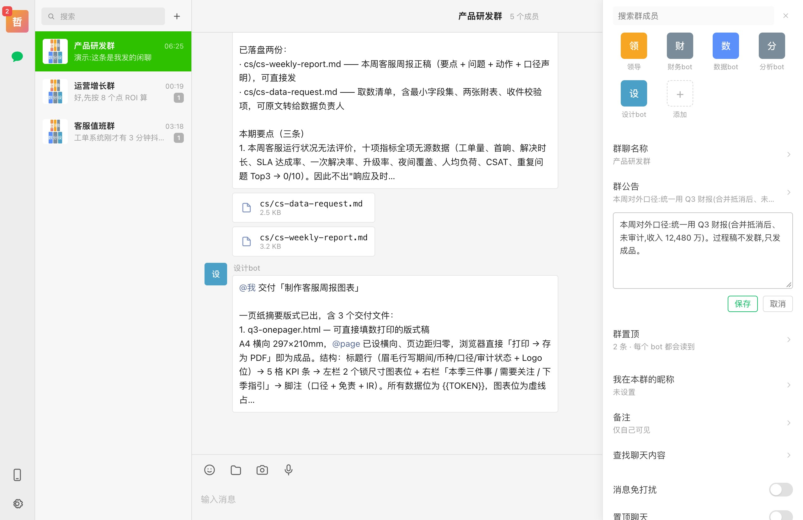
</p>

<p>
  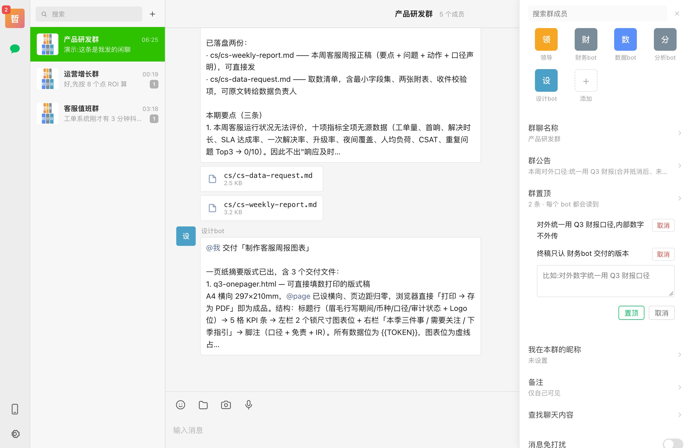
  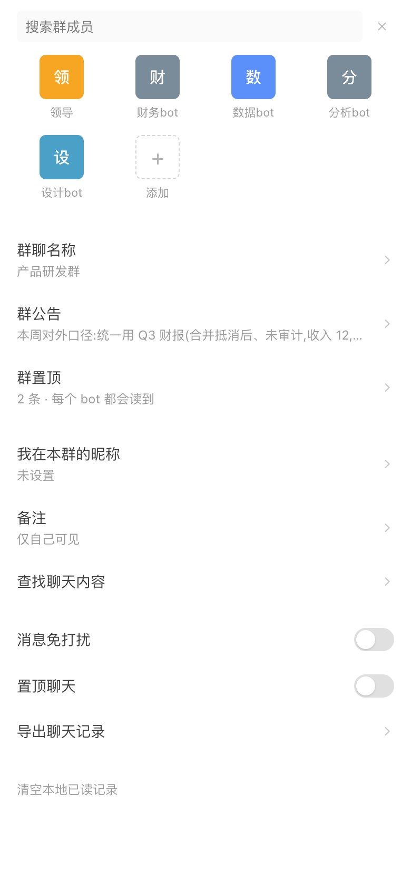
</p>

添加成员是独立弹窗,不是内联展开:左边勾选(可多选)、右边已选列表,底部「取消 / 添加」:

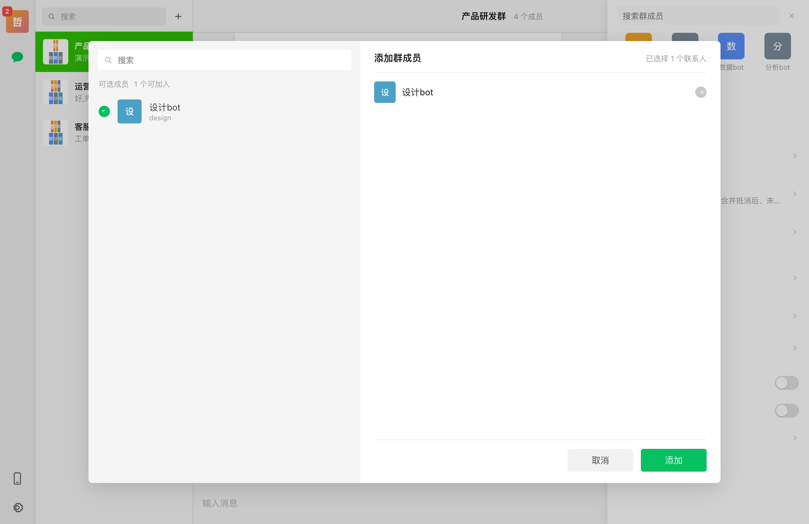

### 输入框的工具都能用

工具栏只剩四个按钮,每个都真的干活(没有「文件夹」这种和「文件」重复的摆设):

| 按钮 | 行为 |
|---|---|
| 表情 | 24 个常用 emoji,点一下插到光标处并保存草稿 |
| 文件 | 系统选文件 → 上传 → 群里一条文件气泡,点击下载 |
| 图片 | 选图 → 直接显示在气泡里,点击看原图 |
| 语音 | `MediaRecorder` 真录音,计时条 + 取消,再点结束并发送,气泡里是可播放的音频 |

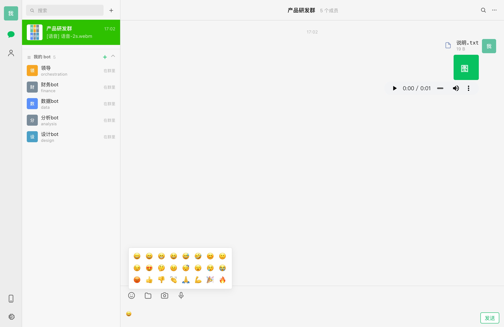

### 交付物能打开、能下载、能归档

文件气泡点开是**渲染后的 markdown**(表格、标题、引用、代码块都是真的,不是一堆 `#` 和 `|`),右上角「原文」看源码、「下载」拿原文件;下载走 `GET /api/groups/:id/files/:workId/<path>`,中文文件名不乱码。

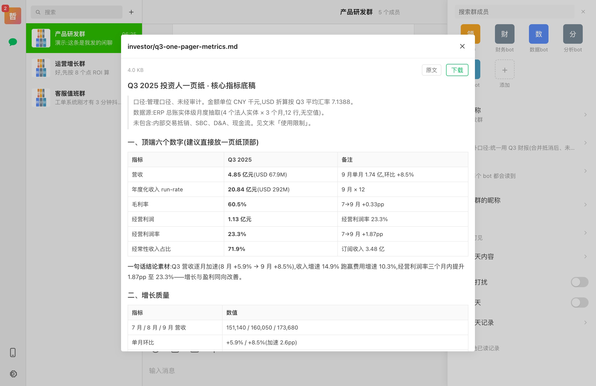

为什么能事后下载:bot 的 scratch 目录每次派单前会被清空,所以 publish 阶段会把交付物**复制到永久归档** `data/archive/<groupId>/<workItemId>/`,artifact 记的就是归档清单。归档只增不减(保留期清理留给外部任务)。

群信息边栏里「导出聊天记录」把整群历史导出成一份 markdown(群公告、置顶、成员、按日期分节的消息、交付正文与附件清单);`?format=json` 是同一份内容的机器可读版。


## 架构(一屏)

```
web(仿微信) ── WS ── server(httpWs)
                        │
                 app(多群编排)
        ┌───────────────┼────────────────┐
   groupStore       scheduler        runtime/群
   (群/置顶文档)     (建任务/取消)     (会话·channel·activity)
                        │
                 WorkItemTask(durable)
      wait_deps → dispatch → publish
                        │
              bot 私有会话(模型 + write_file)
                        │
              workspace/<conversation>/ 交付文件
```

- **群 = 黑板**:只有 `chat.message` 和 `work.event` 两种 entry,永不 `input`。
- **执行私有**:一个 WorkItem 一个 durable Task;卡片在任务提交的**同一个 commit** 里写。
- **单线程 bot**:忙就派人,全忙就排队 + 自轮询,不用 signal。
- **持久化**:群、置顶、工作图、交付物都是 pi-durable 文档;重启复用同一批会话。
- **单写多读**:只读进程可以多开(历史/群列表可看、写 403),群列表靠轮询同步。

## 目录

```
bot/
  src/
    app.ts            组合根:多群、取消、成员、分页、只读
    main.ts           env 装配 + HTTP/WS
    protocol/         类型 / 事件 / 计划校验
    state/            harness、bot 注册表、群文档、工作图、忙闲、记忆、文档定义
    orchestration/    领导分工、调度(含取消)、规则路由
    execution/        WorkItemTask、群 runtime、工作区、write_file 工具、记忆抽取/注入
    publish/          群黑板、工作卡、交付物、回答抽取
    server/           HTTP/WS/静态(webui/dist)+ 只读模式
    config/           bot 名单、模型/网关
  webui/              Vue 3 + Vite 前端源码(src/ 组件化),构建产物 dist/
  web/                旧版零构建前端(index.html + app.js,保留作对照与回退)
  test/               m1 / m2 / features / real.smoke / ui.panel / ui.composer
  docs/               DESIGN.md、WEBUI.md、MEMORY.md、API.md
```

## 接口速查

```
GET    /api/groups
POST   /api/groups {name}
GET    /api/groups/:id
GET    /api/groups/:id/items?limit=&before=
POST   /api/groups/:id/send {text}
POST   /api/groups/:id/requirements {text}
POST   /api/groups/:id/work/:workId/cancel
POST   /api/groups/:id/members {botId}
DELETE /api/groups/:id/members/:botId
GET    /api/bots
POST   /api/bots {name, capability, instructions, avatar, groupId}
GET    /api/profile
PUT    /api/profile {name, signature, avatar}
GET    /api/groups/:id/bots/:botId
PUT    /api/groups/:id/bots/:botId {name?, avatar?, instructions?, model?}
POST   /api/groups/:id/uploads {name,mime,data}
GET    /api/groups/:id/files/:workId/<path>
GET    /api/groups/:id/export?format=md|json
POST   /api/im/:groupId/:token {sender,text}
GET    /api/im/:groupId/:token/outbox?since=
WS     /stream?g=<groupId>
```

细节见 [DESIGN.md §5.5](./docs/DESIGN.md)。

## 已知边界

- 归档目录没有自动清理策略,长期运行需要自己按磁盘配额处理。
- 多进程是**单写多读**:写进程只能有一个;跨进程群列表是轮询(默认 3s)。
- 路由仍是规则,**没有 Jev**;领导分工质量靠提示词,后续用 skill 解决。
- 交付文本上限 12k 字(超出加「已截断」),历史首屏 100 条 + 分页加载。

## 踩过的坑(接手先看)

1. **draft 里 push 的普通对象不被追踪** → 先构造完整对象再 `push`,否则后续赋值静默丢失。
2. **`TaskId` / `ConversationId` 是 number** → 文档存 string,调用前 `Number()`。
3. **工具必须由 extension 装进 registry**;`configure({tools:[x]})` 只是过滤器,否则模型会编出假工具调用。
4. 别在 `cd bot && cmd &` 里后台化(`cd` 会被一起后台);先 `cd`,或用 workdir。

更多见 [docs/DESIGN.md](./docs/DESIGN.md) 的修订记录与 §5.4「踩坑」。
